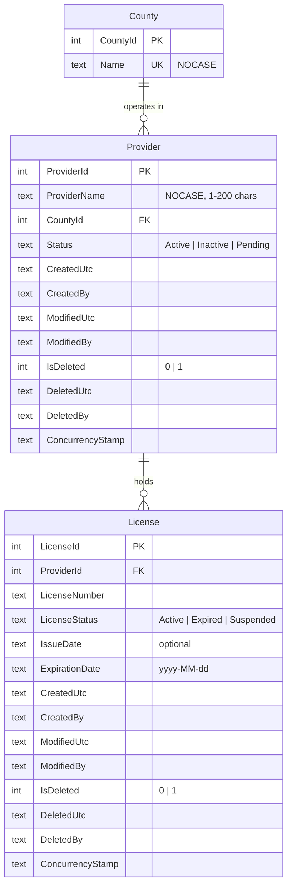

# Candidate Assessment: Provider and License Management

Submission for the Senior Full-Stack .NET Modernization Developer take-home assignment. A React UI, an ASP.NET Core Web API, and a SQLite database that together manage providers and their licenses, with soft deletion enforced in every layer.

**Which requirements this follows.** The repository's own PDF, [Take-Home Technical Assignment](assignment/Take-Home_Technical_Assignment_Formatted.pdf), built against upstream commit `87768d6`. The PDF attached to the original email described an earlier ASP.NET MVC version of the starter; the repository was restructured afterwards, and its README names the PDF in the repository as the requirements source.

## Contents

- [What is included](#what-is-included)
- [Technology stack](#technology-stack)
- [Prerequisites](#prerequisites)
- [Running the application](#running-the-application)
- [Running the tests](#running-the-tests)
- [How the React UI communicates with the C# API](#how-the-react-ui-communicates-with-the-c-api)
- [API reference](#api-reference)
- [Database design decisions](#database-design-decisions)
- [How soft deletion is implemented](#how-soft-deletion-is-implemented)
- [Required data scenarios](#required-data-scenarios)
- [Optional dashboard](#optional-dashboard)
- [Assumptions and trade-offs](#assumptions-and-trade-offs)
- [What I would improve with more time](#what-i-would-improve-with-more-time)
- [Verification steps](#verification-steps)
- [Project layout](#project-layout)

## What is included

| Requirement (PDF section) | Where |
| --- | --- |
| Provider listing, create, edit, soft delete (8.1 to 8.4) | `Providers` view in the UI; `api/providers` |
| License information for a provider (8.5) | `Licenses` button on each provider; `GET api/providers/{id}` |
| Required data scenarios (8.6) | `License reports` view; `api/reports/*`; database views; `02_scenario_queries.sql` |
| C# API with validation and error responses (8.7) | `backend/Candidate.API` |
| React UI with loading, empty, validation, and error states (8.8) | `frontend/React.UI` |
| Optional dashboard (10) | `Dashboard` view; `api/dashboard/summary` |
| SQLite database file | `backend/Candidate.API/Database/Data/providers.db` |
| SQL scripts | `backend/Candidate.API/Database/Scripts/` |
| Tests (not required; added deliberately) | `backend/Candidate.API.Tests`, `frontend/React.UI/src/**/*.test.*` |

A longer log of each decision and the alternatives considered is in [docs/DECISIONS.md](docs/DECISIONS.md).

## Technology stack

| Layer | Technology |
| --- | --- |
| UI | React 19.3.0 and React DOM 19.3.0 (JavaScript) |
| UI tooling | Vite 8.3.4 and `@vitejs/plugin-react` 6.1.2 |
| UI tests | Vitest 5.0.3, Testing Library, jsdom |
| API | ASP.NET Core Web API, C#, `net8.0` |
| Data access | Entity Framework Core 8.0.31 with the SQLite provider |
| Database | SQLite |
| API tests | xUnit, `Microsoft.AspNetCore.Mvc.Testing` 8.0.31, SQLite in memory |
| IDE | Visual Studio 2022 solution (`CandidateAssessment.sln`) |

Material choices:

- **`net8.0` kept.** The starter targets it and its prerequisites list the .NET 8 SDK, so reviewers can run the submission without installing anything else. .NET 8 reaches end of support on November 10, 2026; the upgrade to .NET 10 is listed under improvements.
- **JavaScript kept**, with JSDoc types on the API client, to avoid re-scaffolding the starter.
- **No UI, routing, or charting library.** Four views are switched with component state, and the dashboard bars are plain CSS. Each dependency removed is one less thing to patch.
- **`dotnet-ef` is a local tool** pinned in `dotnet-tools.json`, so everyone runs the same version with `dotnet tool restore`.

## Prerequisites

- [Node.js](https://nodejs.org/) LTS and npm
- [.NET 8 SDK](https://dotnet.microsoft.com/download/dotnet/8.0) or a newer SDK that can build `net8.0` (the .NET 8 targeting pack must be installed)
- Git
- One of:
  - Visual Studio 2022 (17.7 or later) with the **ASP.NET and web development** workload and the **Node.js development** workload
  - Visual Studio Code or Cursor

No database server is needed. SQLite is a file, and the engine ships inside the EF Core package.

## Running the application

The committed `providers.db` already contains the schema and the sample data, so the application runs as cloned.

### VS Code, Cursor, or a terminal

Use two terminals, both starting at the repository root.

API (listens on `http://localhost:5264`):

```bash
dotnet run --project backend/Candidate.API --launch-profile http
```

Frontend (Vite prints its address, normally `http://localhost:5173`):

```bash
cd frontend/React.UI
npm ci
npm run dev
```

Open the Vite address in a browser. Swagger UI for the API is at `http://localhost:5264/swagger`.

### Visual Studio 2022

1. Open `CandidateAssessment.sln`.
2. In a terminal, install frontend dependencies:

   ```bash
   cd frontend/React.UI
   npm ci
   ```

3. Right-click the solution, choose **Configure Startup Projects**, select **Multiple startup projects**, and set **React.UI** and **Candidate.API** to **Start**.
4. Start debugging. Either the `http` or the `https` profile works: both listen on `http://localhost:5264`, which is where the UI sends its requests.

### Resetting the database

In Development the API applies any pending migrations at startup and loads the sample data only when the `Provider` table is empty. To start again from a clean database, stop the API, delete `backend/Candidate.API/Database/Data/providers.db`, and either start the API or run:

```bash
dotnet run --project backend/Candidate.API -- --init-db
```

`--init-db` creates the database, loads the sample data, and exits. The same result can be produced without the application by running `01_schema.sql` and then `03_seed_data.sql` from `backend/Candidate.API/Database/Scripts/` against an empty SQLite file.

### Frontend commands

From `frontend/React.UI`:

| Command | Purpose |
| --- | --- |
| `npm ci` | Install the locked dependencies |
| `npm run dev` | Start the Vite development server (proxies `/api` to the API) |
| `npm run build` | Create the production build in `dist/` |
| `npm run preview` | Preview the production build (also proxies `/api`) |
| `npm test` | Run the UI tests once |

## Running the tests

```bash
dotnet test CandidateAssessment.sln
```

```bash
cd frontend/React.UI
npm test
```

| Suite | What it covers |
| --- | --- |
| Backend (132 tests) | Soft delete in every layer, including raw SQL blocked by trigger; provider rules (duplicates, concurrency, validation); request validation attributes; the license scenarios against a fixed date, including the boundary day; the committed sample data; every route through HTTP |
| Frontend (61 tests) | Form validation rules; the API client's error handling; the provider form; list, filter, delete-confirmation, and license workflows; the scenario reports; loading, empty, and error states |

Backend tests use a real SQLite database in memory, created by the same migrations as the application. The EF Core InMemory provider was avoided on purpose: it enforces no constraints, indexes, triggers, or views, which are the parts most worth testing here.

## How the React UI communicates with the C# API

```text
Browser  --->  Vite dev server (:5173)  --->  ASP.NET Core API (:5264)  --->  SQLite file
         /api/...                proxy              EF Core
```

- **One origin.** The UI calls relative URLs such as `/api/providers`. `vite.config.js` proxies `/api` to `http://localhost:5264`, so the browser only ever talks to the Vite server and no CORS configuration is needed. Set the `API_PROXY_TARGET` environment variable to point the proxy somewhere else.
- **HTTPS redirection is off in Development** (`Program.cs`). A redirect would send the browser from the proxy to a different origin. It stays on in every other environment.
- **One fetch wrapper.** `src/api/client.js` is the only place that calls `fetch`. It sends and reads JSON and converts every failure into an `ApiError` with a message that is safe to show. `src/api/providers.js` has one function per endpoint; components never build URLs.
- **Errors are structured.** The API returns RFC 7807 problem details. For a validation failure (400) the wrapper maps the `errors` object to one message per form field; for not-found (404) and conflict (409) it shows the `detail` text; for a server error or an unreachable API it shows a generic message, never server internals.
- **Data loading.** `src/hooks/useAsync.js` gives every view the same loading, error, and data states, and cancels a superseded request so a slow early response cannot overwrite a later one.
- **No business logic in the UI.** Whether a license is valid or expired, the report contents, and the dashboard counts are all computed by the API. The UI displays `isExpired`, `isCurrentlyValid`, and the counts it is given. Counties and statuses for the dropdowns come from `api/lookups`.
- **Validation in both places, authority in one.** The form checks required fields and length for immediate feedback (`src/validation/providerValidation.js`). The API repeats every rule and adds the ones only it can check (county exists, no duplicate, record not changed by someone else).
- **Production.** There is no proxy in production. The built `dist/` folder would be served by the API itself or sit behind the same gateway as the API, which keeps the single-origin arrangement.

## API reference

| Method and route | Purpose | Responses |
| --- | --- | --- |
| `GET /api/providers` | List providers that are not deleted. Query: `search` (name contains, case-insensitive), `status`, `countyId`, `page`, `pageSize` (1 to 100, default 20) | 200, 400 |
| `GET /api/providers/{id}` | One provider with its licenses and computed validity | 200, 404 |
| `GET /api/providers/{id}/licenses` | The licenses of one provider | 200, 404 |
| `POST /api/providers` | Create a provider | 201 with `Location`, 400, 409 |
| `PUT /api/providers/{id}` | Update a provider; requires `concurrencyStamp` | 200, 400, 404, 409 |
| `DELETE /api/providers/{id}` | Soft-delete a provider | 204, 404 |
| `GET /api/reports/active-providers-active-licenses` | Scenario 1 | 200 |
| `GET /api/reports/active-providers-expired-licenses` | Scenario 2 | 200 |
| `GET /api/audit/providers/deleted` | Soft-deleted providers, for audit | 200 |
| `GET /api/lookups/counties`, `GET /api/lookups/statuses` | Dropdown values | 200 |
| `GET /api/dashboard/summary` | Counts for the dashboard | 200 |

Design choices:

- **A soft-deleted provider is 404** on every standard route: read, update, and delete. Deleting twice returns 404 the second time, not an error.
- **409 Conflict** has two causes: a provider with the same name already exists in the same county, or the `concurrencyStamp` sent with an update is stale because someone else saved first.
- **Optimistic concurrency.** Every read returns a `concurrencyStamp`. An update must send it back; the API replaces it on every save.
- **Structure.** Controllers are thin. Rules live in services (`ProviderService`, `ReportService`, and others), which return a result that is either a value or an expected failure; controllers translate that to HTTP. There is no repository layer on top of EF Core, because `DbContext` is already a unit of work and another layer would add code without adding behaviour.
- **Entities never leave the API.** Requests and responses are separate types in `Contracts/`, so audit columns cannot be set by a client.
- **Paging is rejected, not silently capped.** `pageSize=500` returns 400.

## Database design decisions



**Fields added beyond the data dictionary**

| Addition | Why |
| --- | --- |
| `County` table | A fixed list of Georgia's 159 counties with a foreign key, instead of free text, so "Dekalb", "DeKalb", and "De Kalb" cannot all exist and reports group correctly |
| `CreatedBy`, `ModifiedUtc`, `ModifiedBy` | Audit trail. `CreatedUtc` is the dictionary's `CreatedDate` |
| `IsDeleted`, `DeletedUtc`, `DeletedBy` | Soft delete, described in the next section |
| `ConcurrencyStamp` | Stops two editors from silently overwriting each other |
| `License.IssueDate` | Optional, for context when reading a license |

**Decisions**

- **EF Core migrations are the source of truth** for the schema. Triggers and views, which EF Core does not model, are created with SQL inside the second migration, so one mechanism builds the whole database. `01_schema.sql` is the script generated from the migrations.
- **Integer keys**, not GUIDs: smaller, and readable for support staff looking at the data.
- **Statuses are text with CHECK constraints**, mapped to C# enums. Text is readable in a raw query, and the database itself rejects a value outside the list. An integer enum would be unreadable in the database; a lookup table is more than three fixed values need.
- **Dates are ISO text.** `ExpirationDate` is `yyyy-MM-dd`, so comparing the text compares the dates. Audit timestamps are UTC.
- **Constraints live in the database, not only in C#.** Name length, status values, the delete flag, foreign keys, and uniqueness are all enforced by SQLite, so a script or another application writing to the file cannot store an invalid row. The tests write invalid rows with raw SQL to prove it.
- **`UX_Provider_Name_County` is a partial unique index** (`WHERE IsDeleted = 0`) on name and county, case-insensitive. Two live providers cannot share a name within a county, the same name may exist in different counties, and a deleted provider does not block re-creating one with its name. The sample data includes that case.
- **`UX_License_Provider_Number` is deliberately not partial.** A license number is never reused for the same provider, even after a license is deleted.
- **Other indexes** support the listing: name, and status with county, both limited to live rows.
- **Foreign keys use `RESTRICT`**, never cascade. Nothing is physically deleted, and a license must always keep its provider.
- **County rows ship with the schema** (in the migration), because they are reference data. Sample providers and licenses are separate (`03_seed_data.sql`).

**SQL scripts** in `backend/Candidate.API/Database/Scripts/`:

| Script | Purpose |
| --- | --- |
| `01_schema.sql` | Tables, constraints, indexes, county rows, triggers, and views. Generated with `dotnet ef migrations script`. Builds a database from empty; it is not re-runnable, because EF Core cannot generate idempotent scripts for SQLite |
| `02_scenario_queries.sql` | The required scenarios as hand-written, commented, read-only queries, for running in DB Browser for SQLite without the application |
| `03_seed_data.sql` | The sample data. Re-runnable. The API embeds and runs this same file, so there is one definition of the sample data |

To regenerate `01_schema.sql` after a model change:

```bash
dotnet tool restore
dotnet ef migrations add <Name> --project backend/Candidate.API -o Data/Migrations
dotnet ef migrations script --project backend/Candidate.API -o backend/Candidate.API/Database/Scripts/01_schema.sql
```

## How soft deletion is implemented

A provider or license is deleted by setting `IsDeleted = 1` together with `DeletedUtc` and `DeletedBy`. The row is never removed. The rule is enforced in several independent layers, so that one forgotten `WHERE` clause or one stray `Remove()` call cannot break it.

| Layer | Mechanism | What it guarantees |
| --- | --- | --- |
| 1. Query filter | EF Core global query filters on `Provider` (`!IsDeleted`) and `License` (`!IsDeleted && !Provider.IsDeleted`), in `Data/Configurations/` | Every query through the application excludes deleted rows without each query having to remember to. This is how the listing in section 8.1 excludes them: no service contains an `IsDeleted` condition |
| 2. Save interceptor | `AuditSoftDeleteInterceptor` rewrites any EF delete of these entities into an update that sets the delete columns | Calling `Remove()` anywhere in the code base results in a soft delete |
| 3. Triggers | `TR_Provider_BlockDelete` and `TR_License_BlockDelete` abort any `DELETE` statement | A hard delete fails even from raw SQL or another tool |
| 4. Constraints | CHECK: `IsDeleted` and `DeletedUtc` must agree | The flag cannot say one thing and the timestamp another |
| 5. Views | `vw_Providers` and the scenario views filter `IsDeleted = 0` | People querying the database directly get the same exclusion |

Supporting decisions:

- **Flag plus timestamp, rather than timestamp only.** `IsDeleted` makes intent obvious to anyone reading the table and makes the partial indexes read naturally. The CHECK constraint removes the usual risk of the two drifting apart.
- **Deleted is not a status.** `Inactive` is a business state and such a provider still appears in listings. Deletion is a record state held in its own columns.
- **Licenses are hidden through their provider, not flagged one by one.** Deleting a provider does not touch its license rows. They disappear from standard results because the license filter looks at the provider. A future restore is then a single-row change, and the audit trail shows exactly what the user did.
- **Deleted records stay queryable for audit** in three ways: `GET /api/audit/providers/deleted` and the `Deleted (audit)` view in the UI; the `vw_DeletedProvidersAudit` database view; and plain SQL (examples in `02_scenario_queries.sql`). In code, `AuditService` is the only class that calls `IgnoreQueryFilters()`.
- **Who deleted it.** There is no authentication in the assignment, so `DeletedBy`, `CreatedBy`, and `ModifiedBy` are filled from an `ICurrentUser` abstraction that returns the placeholder `anonymous`. Adding authentication means replacing that one class.

## Required data scenarios

| Scenario | API | UI | Database |
| --- | --- | --- | --- |
| Active providers and their active licenses | `GET /api/reports/active-providers-active-licenses` | License reports, first tab | `vw_ActiveProvidersActiveLicenses` |
| Providers appearing active but having expired licenses | `GET /api/reports/active-providers-expired-licenses` | License reports, second tab | `vw_ActiveProvidersExpiredLicenses` |
| Exclusion of soft-deleted providers | Every standard endpoint | Every view except Deleted (audit) | `vw_Providers` |

License validity is defined once, in `Domain/LicenseRules.cs`:

- **Expired:** `ExpirationDate` is before today, whatever the stored `LicenseStatus` says.
- **Currently valid:** stored `LicenseStatus` is `Active` and `ExpirationDate` is today or later.
- A provider's own status is never used to decide whether a license is valid.

The sample data covers each case with one provider or more: all licenses valid; one expired and one valid; stored status still `Active` after the date passed; only a suspended license; no licenses; inactive and pending providers; an inactive provider that still holds a valid license; two soft-deleted providers; and a provider re-created with the name of a deleted one. `03_seed_data.sql` lists them. Sample dates are in 2024 to 2025 or 2030 and later, so the scenarios do not change as time passes, and a test fails if the sample data ever stops demonstrating a scenario.

## Optional dashboard

The `Dashboard` view is read-only and draws what `GET /api/dashboard/summary` returns. Nothing is computed in the browser.

Metrics were chosen for compliance risk first:

- **Active providers with no valid license** and **active providers with an expired license**: the two numbers that mean someone needs to act. The cards turn red when they are above zero.
- **Valid licenses expiring in the next 90 days**: the work that is coming.
- **Providers by status, licenses by validity today, providers by county**: context for the numbers above.

The bars are plain CSS rather than a charting library, which is enough for a handful of counts.

## Assumptions and trade-offs

1. **Requirements version.** The repository PDF is followed, not the older emailed PDF.
2. **"Do not add or remove files unless instructed."** Read as: do not delete or rename starter files. Files the assignment calls for (EF Core model, endpoints, UI, scripts, database) and the test project were added.
3. **Soft delete scope.** Only provider deletion is exposed, as required. License rows have the same soft-delete columns and protections for consistency, but there is no license delete endpoint.
4. **Expiration date is inclusive.** A license is valid through the end of its expiration date and expired the next day.
5. **Which "today."** The API uses the current date in US Eastern time, from an injectable clock. A UTC date would roll over at 7 or 8 p.m. in Georgia and expire licenses a day early. Database views cannot take a parameter, so they use the local date of the machine running the query; they are troubleshooting aids, and the API does not read them.
6. **"Providers appearing active but having expired licenses"** means provider status `Active`, not deleted, with at least one expired license. Each row also carries `hasNoValidLicense`, so the stricter reading (nothing valid left) is answerable from the same result.
7. **"Active providers and their active licenses"** keeps an active provider that has no valid license, with an empty list. Leaving it out would hide a compliance problem.
8. **A stored `Expired` status with a future date** is treated as not valid and not expired by date. The data is contradictory; the rule follows the assignment's statement that expiration is determined by `ExpirationDate`.
9. **License number uniqueness** is per provider, as the data dictionary says ("usually unique per provider"). Real state license numbers are often globally unique; that is a question for the business.
10. **Provider name uniqueness** is per county among live providers. The assignment does not state a rule; this prevents accidental double entry without forbidding the same name in two counties.
11. **County is a fixed list of Georgia counties.** The list of 159 was entered from memory and checked only for count, duplicates, and order. It should be compared with an official source before real use.
12. **Restore is out of scope.** The schema supports it; no endpoint is provided.
13. **Audit depth.** Who and when for create, last change, and delete. There is no history of each individual change.
14. **The audit endpoint is open** because there is no authentication. In production it would require an auditor or support role.
15. **Search uses `LIKE '%text%'`**, which cannot use the name index. Acceptable at this size.
16. **Migrations and sample data at startup** are a Development convenience. Production would run migrations from the release pipeline and would not load sample data.
17. **SQLite is single-writer.** Fine for this exercise. A multi-user system would move to SQL Server or Azure SQL, where the same design maps to filtered indexes and `INSTEAD OF DELETE` triggers.
18. **The UI was verified by automated tests and by calling the API through the dev proxy**, not by a visual review in a browser.

## What I would improve with more time

- Authentication and authorization, with real user names in the audit columns and a restricted audit endpoint.
- A restore operation for soft-deleted providers.
- A change-history table recording each change with before and after values.
- License create, edit, and delete in the API and UI.
- Upgrade to .NET 10 before .NET 8 leaves support in November 2026.
- A CI pipeline that builds, runs both test suites, and checks that `01_schema.sql` matches the migrations.
- TypeScript, or types generated from the API's OpenAPI document, so the UI and API contracts cannot drift.
- End-to-end browser tests for the main workflows, and an accessibility review.
- Sorting on the provider list, and URLs per view so a page can be bookmarked.
- Structured logging with correlation identifiers, and a health-check endpoint.
- Server-side caching of the lookup lists.
- A search index if the provider table grows beyond what a scan handles comfortably.

## Verification steps

From a clean checkout, with Node.js and the .NET SDK on `PATH`:

```bash
dotnet tool restore
dotnet build CandidateAssessment.sln
dotnet test CandidateAssessment.sln
cd frontend/React.UI
npm ci
npm test
npm run build
```

Then start both applications as described in [Running the application](#running-the-application).

Expected results:

- The solution build succeeds for `Candidate.API`, `Candidate.API.Tests`, and `React.UI`.
- Both test suites pass.
- The API reports no startup exception. Swagger UI at `http://localhost:5264/swagger` lists the routes in the [API reference](#api-reference).
- The React page lists 11 providers, ten per page. `Albany Tiny Tots` is not among them and appears under `Deleted (audit)`.
- `License reports` shows seven providers on the first tab and three on the second.
- Deleting a provider asks for confirmation, removes it from the list, and adds it to `Deleted (audit)`. The row is still in the `Provider` table with `IsDeleted = 1`.
- With the API stopped, the UI shows an error message with a `Try again` button instead of a blank page.

Stop the API before committing `providers.db`, and confirm no `providers.db-wal` or `providers.db-shm` file remains beside it.

## Project layout

```text
CandidateAssessment.sln
dotnet-tools.json                 Pins the dotnet-ef local tool
assignment/                       Official assignment PDF and submission guide
docs/DECISIONS.md                 Decision log
backend/Candidate.API/
  Controllers/                    HTTP only: routing, status codes, problem responses
  Contracts/                      Request and response types, validation attributes
  Services/                       Business rules, reports, clock, current user
  Domain/                         Entities, enums, license rules, county list
  Data/                           DbContext, entity configurations, interceptor, migrations
  Database/Scripts/               01_schema.sql, 02_scenario_queries.sql, 03_seed_data.sql
  Database/Data/providers.db      The SQLite database
backend/Candidate.API.Tests/      xUnit tests
frontend/React.UI/
  src/api/                        fetch wrapper and one function per endpoint
  src/pages/                      Providers, License reports, Dashboard, Deleted (audit)
  src/components/                 Form, dialogs, license table, shared states
  src/hooks/                      Data loading
  src/validation/                 Form validation rules
```
